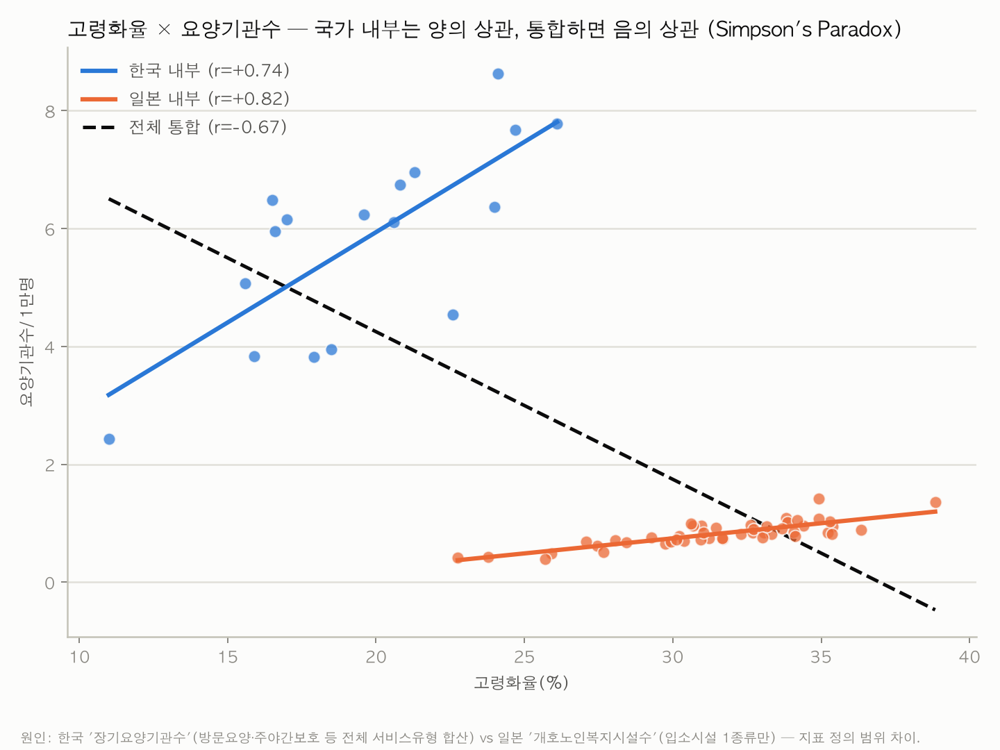
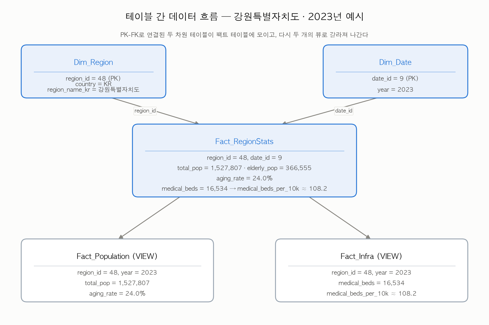
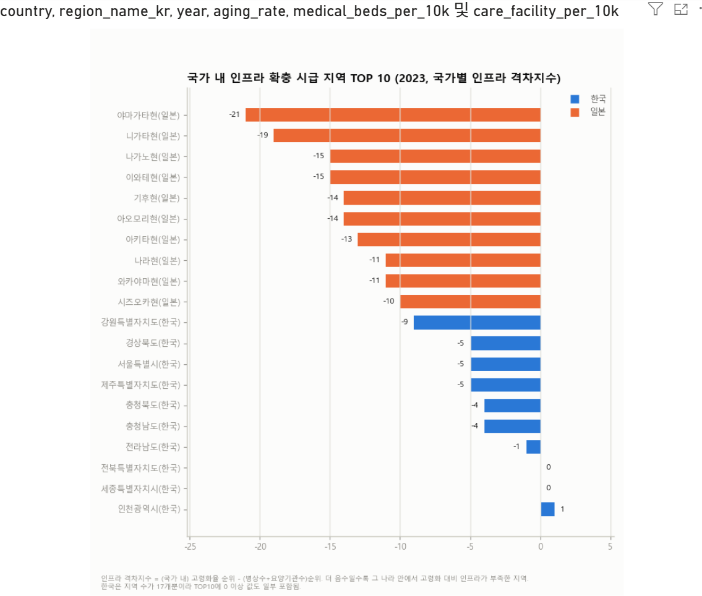

# 한·일 지역별 고령화와 의료·돌봄 인프라 격차 분석

한국 17개 시·도와 일본 47개 도도부현(64개 지역, 2015~2023)의 고령화율과 의료·돌봄 인프라를 양국 공공 API에서 직접 수집해 SQL DB로 구축하고 분석한 3인 팀 프로젝트(SilverLink팀, kmove 미니프로젝트, 3주).

**핵심 발견:** 고령화율과 장기요양기관 밀도의 상관계수는 한국 안에서 +0.74, 일본 안에서 +0.82인데, 두 나라를 합쳐서 계산하면 −0.67로 부호가 뒤집힌다. 원인은 데이터 오류가 아니라 두 나라가 "요양기관"을 서로 다른 범위로 집계하기 때문이었다(심슨의 역설). 국가 간 통계를 합쳐 분석하기 전에 지표 정의부터 맞춰봐야 한다는 점을 데이터로 확인했다.



## 내가 한 일 (데이터 전처리 담당)

- **수집:** e-Stat REST API, KOSIS Open API 수집 코드 작성. 일본 인구 원자료가 5년 주기 국세조사뿐이라 연도별 분석이 불가능한 문제를 찾아, 매년 발표되는 인구추계 통계표로 소스를 바꿔 해결했다.
- **정제·적재:** pandas로 정제해 SQLite 스타 스키마(64개 지역 × 9개년 = 576행)로 적재했다. 같은 과정을 SQL만으로 다시 구현해(`sql_cleaning/` 18개 파일) 576행 전부 값이 일치하는지 대조했다.
- **분석:** 개인 보고서에서 위 상관관계 반전의 원인을 국가 내부/국가 간 관계로 나눠 분석했다([`개인보고서/보고서_심슨의역설.md`](개인보고서/보고서_심슨의역설.md)).

팀 공동 작업은 분석 질문 설계, SQL 분석 쿼리(`sql/analysis/q1~q5`), Power BI 대시보드(DAX 측정값), 발표자료다.

| 구분 | 사용 기술 |
|---|---|
| 수집·전처리 | Python (`requests`, `pandas`) |
| DB·분석 | SQLite, SQL (스타 스키마, 뷰, self-JOIN) |
| 시각화 | Power BI (DAX, 팀), matplotlib |

**바로가기:** [발표자료 PDF](presentation/발표자료.pdf) · [Power BI 최종 그래프 10종 PDF](powerbi/PowerBI_최종그래프_10종.pdf) · [개인 보고서](개인보고서/보고서_심슨의역설.md) · [기획서](docs/기획서.md)

## 문제 정의

한국은 고령화가 빠르게 진행되고 있고, 일본은 2007년에 이미 초고령사회에 들어섰다. 일본이 먼저 겪은 문제에 한국이 어떻게 대비할지 보려면 두 나라 평균을 비교하는 것만으로는 부족하고, **어느 지역이 고령화에 비해 인프라가 부족한지**를 지역 단위로 봐야 한다고 생각했다.

## 시스템 구조 / 처리 흐름


DB 구조는 지역(`Dim_Region`)과 연도(`Dim_Date`)를 차원으로 둔 스타 스키마다. 아래는 강원특별자치도 2023년 한 행이 테이블 사이를 어떻게 흐르는지 보여준다.



## 결과

- DB 규모: `Dim_Region` 64행(한국 17 + 일본 47) · `Dim_Date` 9개년(2015~2023) · `Fact_RegionStats` 576행. pandas 적재 결과와 순수 SQL 파이프라인 결과는 576행 전부 값까지 일치했다(`scripts/build_cleaning_db.py`).
- Insight 1. 한국의 고령화 속도는 일본의 약 1.8배다. 2015~2023년 평균 고령화율 한국 13.8%→19.6%(연 +0.72%p) vs 일본 28.3%→31.6%(연 +0.41%p). 증가폭 TOP5: 부산(+8.0%p)·강원(+7.1%p)·울산(+7.1%p)·경북(+7.0%p)·대구(+6.9%p).
- Insight 2. 64개 지역 전체로 순위를 매기면 취약 지역이 잘 보이지 않는다. 인프라 격차 상위 15곳이 모두 일본 지역으로 나오는데, 일본의 고령화율이 전반적으로 한국보다 높기 때문이다. 국가별로 나눠 순위를 매기면 한국은 강원특별자치도(인구 1만명당 병상수 108.2, 17개 시·도 평균 151.8보다 29% 낮음), 일본은 야마가타현이 각국 내 인프라 확충 최우선 지역으로 나타난다.
- Insight 3. 지표 정의 차이가 상관관계 부호를 뒤집는다(Simpson's paradox). 고령화율×장기요양 인프라밀도 상관계수가 한국 내부 +0.742, 일본 내부 +0.819로 둘 다 양의 상관인데, 두 나라를 합쳐서 계산하면 -0.673으로 반전된다. 원인은 한국 KOSIS "장기요양기관"(방문·주야간보호·시설 전체)과 일본 e-Stat "介護老人福祉施設"(입소시설 1종)의 집계 범위 차이다.

Insight 2를 Power BI로 시각화한 결과(국가별 인프라 확충 시급 지역 TOP10):



## 트러블슈팅

전처리를 하면서 막혔던 문제와 해결 방법이다. 자세한 내용은 `docs/전처리_로그.md`에 있다.

1. **장기요양기관 수가 지역마다 중복 집계되는 버그**
   - 원인: KOSIS API 응답의 2차 분류축(`C2_NM`, 시설유형 세부구분)을 무시하고 수집해서, "계"(합계) 행과 세부유형 행이 같은 항목명으로 뭉개져 region×year당 값이 중복됐다.
   - 해결: `collect_kosis_korea.py`가 `category2` 컬럼을 보존하도록 수정해 재수집하고, 전처리 단계에서 `category2 == '계'`인 행만 사용하도록 필터를 추가했다.
2. **일본 인구 데이터가 2015·2020 두 시점뿐이라 연도별 추이 분석이 불가능**
   - 원인: 처음 수집한 소스가 5년 주기 국세조사(센서스) 원자료였다.
   - 해결: e-Stat의 연도별 인구추계(人口推計) 통계표로 소스를 교체해 2015~2024 매년 데이터를 확보했다(단위가 千人이라 ×1000 환산 처리 추가).
3. **한국·일본 데이터의 수집 가능 연도 범위가 달라 결측치가 생김**
   - 원인: 인구 데이터는 2024년까지 있었지만, 일본 의료·복지 인프라 원자료는 2023년까지만 존재했다.
   - 해결: 적재 연도를 2015~2023으로 통일(원본 CSV는 2024년분까지 그대로 보존하고 로드 시에만 필터링)해 결측을 없앴다.

## 실행 방법

```bash
# 1. 설치
pip install -r requirements.txt

# 2. 데이터 준비: 프로젝트 루트에 .env 생성
#    ESTAT_APP_ID=발급받은_appId      (e-Stat 회원가입 후 마이페이지 > API機能)
#    KOSIS_API_KEY=발급받은_인증키    (KOSIS Open API > 활용신청)

# 3. 실행 (수집 → 전처리/적재 → 분석 → 시각화)
python scripts/collect_estat_japan.py
python scripts/collect_kosis_korea.py
python scripts/preprocess_and_load.py      # data/aging_infra.db 생성
python scripts/run_analysis.py             # sql/analysis/q1~q5.sql 실행
python scripts/visualize.py                # figures/*.png 생성

# (선택) 순수 SQL로 같은 결과를 재현해 pandas 적재 결과와 대조
python scripts/build_cleaning_db.py
```

상세 출처(통계표 ID·URL)는 [`docs/데이터출처.md`](docs/데이터출처.md), 전처리 규칙 전체는 [`docs/전처리_로그.md`](docs/전처리_로그.md) 참고.

## 폴더 구조

| 경로 | 내용 |
|---|---|
| [`docs/`](docs) | 기획서, 데이터출처, 데이터사전, 전처리 로그 |
| [`scripts/`](scripts) | 수집·전처리·분석·시각화 Python 파이프라인 |
| [`sql/`](sql) | DDL, 분석 쿼리(q1~q5) |
| [`sql_cleaning/`](sql_cleaning) | 전처리 전 과정을 SQL만으로 재현한 교차검증 파이프라인(00~17번) |
| [`data/`](data) | 원본 CSV(`raw/`), 정제 CSV(`cleaned/`), SQL DB(`aging_infra.db`) |
| [`figures/`](figures) | matplotlib 시각화 27장(최종 선정 10장과 생성 스크립트는 [`figures/README.md`](figures/README.md)) |
| [`powerbi/`](powerbi) | Power BI 최종 그래프 10종(PDF)과 스크린샷 |
| [`개인보고서/`](개인보고서) | 개인 보고서 [`보고서_심슨의역설.md`](개인보고서/보고서_심슨의역설.md): 지표 정의 차이가 상관관계 부호를 뒤집는 원인 분석. [`검증_노트.md`](개인보고서/검증_노트.md)에 보고서 수치를 DB로 재검증한 과정 기록 |
| [`presentation/`](presentation) | 최종 발표자료(PDF, 51장) |

## 아쉬운 점 / 개선하고 싶은 점

- 인프라 격차지수의 단위 스케일 문제: 병상수와 요양기관수를 단순 합산해 순위를 매기다 보니 단위 규모가 큰 병상수 쪽에 결과가 좌우된다(`sql/analysis/q5.sql` 주석에 명시). 표준화(z-score) 버전으로 보완하고 싶다.
- 한/일 "장기요양기관" 정의 차이를 보정하는 지표를 아직 못 만들었다. Insight 3에서 발견한 Simpson's paradox의 원인(집계 범위 차이)까지는 밝혔지만, 입소시설만 따로 집계해 정의를 맞춘 보정 지표는 다음 과제로 남았다.
- Power BI를 직접 다루지 못했다. 팀 대시보드와 DAX 측정값은 팀원들과 함께 설계했지만, 내 작업 환경이 macOS라 Power BI Desktop에서 직접 구현하지는 못하고 matplotlib으로 대신 그래프를 그렸다. 다음에는 DAX 측정값을 직접 만들어보고 싶다.
- 일본 2024년 의료·복지 데이터가 결측이다. 원자료 공개 주기 때문에 최신 연도 비교에 1년의 시차가 남아있다.
