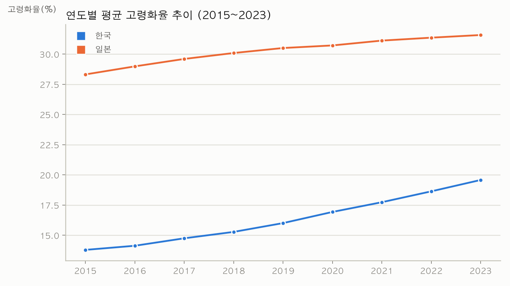
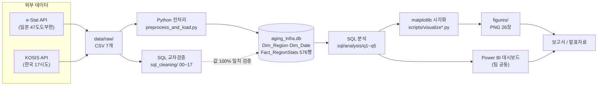

# 한·일 지역별 고령화와 의료·돌봄 인프라 격차 분석

한국 17개 시·도 / 일본 47개 도도부현의 **고령화율**과 **의료·돌봄 인프라(인구 1만명당 병상수·장기요양기관수)** 수준 간 관계를 데이터로 검증하는 kmove 미니프로젝트. 두 나라를 합쳐서 보면 숨어버리는 지역별 진짜 인프라 공백을, 국가별 순위 비교로 걷어내는 것이 핵심 목표다.



## 문제 정의

한국은 세계에서 가장 빠른 속도로 고령화가 진행 중이고, 일본은 이미 초고령사회를 20년 넘게 경험하고 있다. "일본이 먼저 겪은 문제를 한국이 어떻게 준비해야 하는가"라는 질문에 답하려면, 단순히 두 나라의 평균 수치를 나열하는 것이 아니라 **어느 지역이 고령화 대비 인프라가 실제로 부족한지**를 구조적으로 짚어내야 한다. 이 프로젝트는 e-Stat(일본 정부통계포털)·KOSIS(한국 국가데이터처) 공식 API에서 원본 데이터를 직접 수집해 SQL DB로 적재하고, 분석 쿼리와 시각화로 지역 단위의 인프라 격차를 찾는다.

## 내 역할 (데이터 전처리) / 팀 작업

커피팀(홍성현·팀원·팀원, 3주·총 60시간) 프로젝트. 역할을 명확히 구분하면:

| 구분 | 내용 |
|---|---|
| **개인 담당 (홍성현 — 데이터 전처리)** | e-Stat/KOSIS API 수집 스크립트(`scripts/collect_*.py`), pandas 기반 정제·DB 적재(`preprocess_and_load.py`), SQL만으로 같은 과정을 재현해 교차검증하는 파이프라인(`sql_cleaning/`, `build_cleaning_db.py`), 데이터 품질 이슈 발견·수정(아래 트러블슈팅 참고) |
| **팀 공동 작업** | 분석 질문 설계(`docs/기획서.md` 3.1), SQL 분석 쿼리(`sql/analysis/q1~q5`), Power BI 대시보드(스크린샷: `powerbi/그래프이미지/`), 최종 보고서·발표자료 |

## 기술 스택

- **수집**: Python `requests` — e-Stat REST API, KOSIS Open API
- **정제·적재**: Python `pandas` → SQLite (`data/aging_infra.db`)
- **정제 교차검증**: 순수 SQL 파이프라인(`sql_cleaning/`, SELECT/WHERE/CASE/GROUP BY/JOIN만 사용) — pandas 결과와 576행 전부 값 대조
- **분석**: SQL (`sql/analysis/q1~q5.sql`)
- **시각화**: Python `matplotlib`(원래 계획은 Power BI였으나 macOS 환경 제약으로 대체), 팀 Power BI 대시보드(`.pbix`, 스크린샷만 레포에 포함)

## 시스템 구조 / 처리 흐름



## 결과

아래 수치는 모두 `sql/analysis/*.sql` 실행 결과 주석, `docs/기획서.md` Insight 절, `scripts/visualize.py` 실행 로그에서 확인한 값이다.

- DB 규모: `Dim_Region` 64행(한국 17 + 일본 47) · `Dim_Date` 9개년(2015~2023) · `Fact_RegionStats` 576행. pandas 적재 결과와 순수 SQL 파이프라인 재현 결과가 576행 전부 값까지 일치함을 직접 대조 검증했다(`scripts/build_cleaning_db.py` 실행 로그).
- Insight 1. 한국의 고령화 속도는 일본의 약 1.8배다. 2015~2023년 평균 고령화율 한국 13.8%→19.6%(연 +0.72%p) vs 일본 28.3%→31.6%(연 +0.41%p). 증가폭 TOP5: 부산(+8.0%p)·강원(+7.1%p)·울산(+7.1%p)·경북(+7.0%p)·대구(+6.9%p).
- Insight 2. 전역 순위로는 진짜 취약 지역이 가려진다. 64개 지역을 한 줄로 순위화하면 인프라 격차 상위 15곳이 전부 일본으로 쏠린다(일본 전체가 한국보다 고령화율이 높아서 생기는 구조적 편향). 국가별로 나눠 순위를 매기면 한국은 강원특별자치도(인구 1만명당 병상수 108.2, 전국평균 151.8 대비 29%↓), 일본은 야마가타현이 각국 내 인프라 확충 최우선 지역으로 나타난다.
- Insight 3. 지표 정의 차이가 상관관계 부호를 뒤집는다(Simpson's paradox). 고령화율×장기요양 인프라밀도 상관계수가 한국 내부 +0.742, 일본 내부 +0.819로 둘 다 양의 상관인데, 두 나라를 합쳐서 계산하면 -0.673으로 반전된다. 원인은 한국 KOSIS "장기요양기관"(방문·주야간보호·시설 전체)과 일본 e-Stat "介護老人福祉施設"(입소시설 1종)의 집계 범위 차이다.

  

## 트러블슈팅

데이터 전처리 담당자로서 실제로 막혔던 문제와 해결 과정(근거: `docs/전처리_로그.md`).

1. **장기요양기관 수가 지역마다 중복 집계되는 버그**
   - 원인: KOSIS API 응답의 2차 분류축(`C2_NM`, 시설유형 세부구분)을 무시하고 수집해서, "계"(합계) 행과 세부유형 행이 같은 항목명으로 뭉개져 region×year당 값이 중복됐다.
   - 해결: `collect_kosis_korea.py`가 `category2` 컬럼을 보존하도록 수정해 재수집하고, 전처리 단계에서 `category2 == '계'`인 행만 사용하도록 필터를 추가했다.
2. **일본 인구 데이터가 2015·2020 두 시점뿐이라 연도별 추이 분석이 불가능**
   - 원인: 처음 수집한 소스가 5년 주기 국세조사(센서스) 원자료였다.
   - 해결: e-Stat의 연도별 인구추계(人口推計) 통계표로 소스를 교체해 2015~2024 매년 데이터를 확보했다(단위가 千人이라 ×1000 환산 처리 추가).
3. **한국·일본 데이터의 수집 가능 연도 범위가 달라 결측치가 생김**
   - 원인: 인구 데이터는 2024년까지 있었지만, 일본 의료·복지 인프라 원자료는 2023년까지만 존재했다.
   - 해결: 적재 연도를 2015~2023으로 통일(원본 CSV는 2024년분까지 그대로 보존하고 로드 시에만 필터링)해 결측을 없앴다.

## 실행 방법

```bash
# 1. 설치
pip install -r requirements.txt

# 2. 데이터 준비 — 프로젝트 루트에 .env 생성
#    ESTAT_APP_ID=발급받은_appId      (e-Stat 회원가입 후 마이페이지 > API機能)
#    KOSIS_API_KEY=발급받은_인증키    (KOSIS Open API > 활용신청)

# 3. 실행 (수집 → 전처리/적재 → 분석 → 시각화)
python scripts/collect_estat_japan.py
python scripts/collect_kosis_korea.py
python scripts/preprocess_and_load.py      # data/aging_infra.db 생성
python scripts/run_analysis.py             # sql/analysis/q1~q5.sql 실행
python scripts/visualize.py                # figures/*.png 생성

# (선택) 순수 SQL로 같은 결과를 재현해 pandas 적재 결과와 대조
python scripts/build_cleaning_db.py
```

상세 출처(통계표 ID·URL)는 [`docs/데이터출처.md`](docs/데이터출처.md), 전처리 규칙 전체는 [`docs/전처리_로그.md`](docs/전처리_로그.md) 참고.

## 폴더 구조

| 경로 | 내용 |
|---|---|
| [`docs/`](docs) | 기획서, 데이터출처, 데이터사전, 전처리 로그 |
| [`scripts/`](scripts) | 수집·전처리·분석·시각화 Python 파이프라인 |
| [`sql/`](sql) | DDL, 분석 쿼리(q1~q5) |
| [`sql_cleaning/`](sql_cleaning) | 전처리 전 과정을 SQL만으로 재현한 교차검증 파이프라인(00~17번) |
| [`data/`](data) | 원본 CSV(`raw/`), 정제 CSV(`cleaned/`), SQL DB(`aging_infra.db`) |
| [`figures/`](figures) | matplotlib 시각화 26장 |
| [`powerbi/`](powerbi) | Power BI 대시보드 스크린샷 |
| [`개인보고서/`](개인보고서) | 개인 보고서 [`보고서_심슨의역설.md`](개인보고서/보고서_심슨의역설.md): 지표 정의 차이가 상관관계 부호를 뒤집는 원인 분석. [`검증_노트.md`](개인보고서/검증_노트.md)에 보고서 수치를 DB로 재검증한 과정 기록 |
| [`presentation/`](presentation) | 발표 대본 |
| [`archive/`](archive) | 대체된 구버전 산출물 보관(참고용) |

## 아쉬운 점 / 개선하고 싶은 점

- 인프라 격차지수의 단위 스케일 문제: 병상수와 요양기관수를 단순 합산해 순위를 매기다 보니 단위 규모가 큰 병상수 쪽에 결과가 좌우된다(`sql/analysis/q5.sql` 주석에 명시). 표준화(z-score) 버전으로 보완하고 싶다.
- 한/일 "장기요양기관" 정의 차이를 보정하는 지표를 아직 못 만들었다. Insight 3에서 발견한 Simpson's paradox의 원인(집계 범위 차이)까지는 밝혔지만, 입소시설만 따로 집계해 정의를 맞춘 보정 지표는 다음 과제로 남았다.
- Power BI를 끝까지 활용하지 못했다. macOS 환경 제약으로 모델링·DAX 설계는 문서로만 남기고 실제 대시보드는 matplotlib으로 대체했다. Windows/Power BI 환경에서 원래 설계한 DAX 측정값(`docs/기획서.md` 3.4)을 직접 구현해보고 싶다.
- 일본 2024년 의료·복지 데이터가 결측이다. 원자료 공개 주기 때문에 최신 연도 비교에 1년의 시차가 남아있다.
