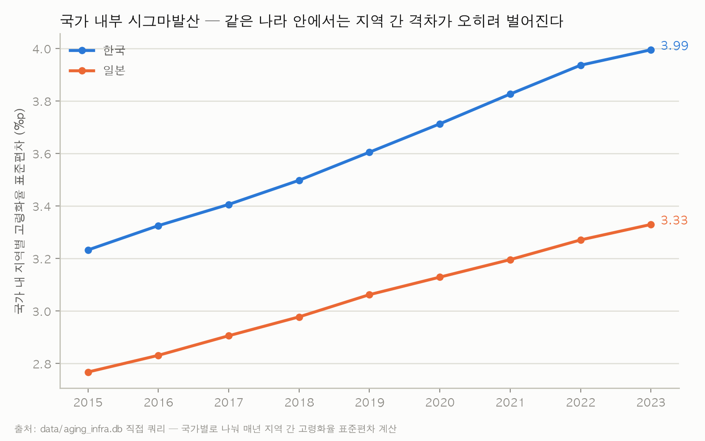

# [개인 보고서] 한·일 고령화율과 요양인프라의 상관관계에서 나타난 심슨의 역설

데이터 수집, DB 설계, SQL 정제, Power BI 대시보드는 팀 공동 작업물을 사용했고,
분석 방향과 해석, 본문 서술은 개인적으로 작성했다.

---

## 1. 서론

### 1.1 문제 제기

한국과 일본의 지역별 고령화율과 장기요양인프라 밀도(인구 1만명당 장기요양기관 수)를
비교하다가 이상한 점을 발견했다. 두 변수의 상관관계가 어느 범위에서 계산하느냐에
따라 방향이 정반대로 나온 것이다.

- 한국 17개 시·도만 보면 r = +0.742 (고령화율이 높은 지역일수록 요양기관도 많다)
- 일본 47개 도도부현만 보면 r = +0.819 (마찬가지로 양의 상관)
- 두 나라를 합쳐 64개 지역 전체로 보면 r = −0.673 (부호가 반대)

데이터와 변수는 그대로인데, 국가별로 나눠 보느냐 합쳐 보느냐에 따라 상관관계의
부호가 바뀌었다. 이렇게 부분집단마다 나타나는 경향이 전체를 합쳤을 때 사라지거나
반대로 나타나는 현상을 심슨의 역설(Simpson's Paradox)이라고 한다.

### 1.2 이 사례를 택한 이유

처음에는 계산 실수를 의심했지만, 다시 확인해도 결과는 같았다. 만약 64개 지역을
합친 결과만 봤다면 "요양인프라가 많은 곳일수록 고령화율이 낮다"는, 실제로는 없는
관계를 근거로 삼았을 수 있다. 이런 문제는 고령화뿐 아니라 의료, 복지, 경제 지표 등
국가 간 데이터를 합쳐서 분석할 때 언제든 생길 수 있다. 그래서 여러 사례를 나열하기보다
이 사례 하나를 자세히 살펴보기로 했다.

### 1.3 연구 질문

> 한국·일본의 지역별 고령화율과 장기요양인프라 밀도는 왜 국가 내부에서 볼 때와
> 두 나라를 합쳐서 볼 때 상반된 상관관계를 보이는가?

다음 세 가지 순서로 답한다.

1. 부호 반전이 실제로 나타나는가, 얼마나 강한가 (3장)
2. 왜 반전이 일어나는가, 통계적으로 어떤 구조이고 원인은 무엇인가 (4장)
3. 이 결과에서 얻을 수 있는 정책적·방법론적 시사점은 무엇인가 (5장)

---

## 2. 데이터 및 방법론

### 2.1 데이터

일본 총무성 통계국 e-Stat API와 한국 KOSIS Open API에서 받은 공식 통계를 사용했다.
분석 대상은 한국 17개 시·도와 일본 47개 도도부현을 합친 64개 지역이다. 기준 연도는
2023년으로 잡았는데, 일본의 의료·복지 자료가 2023년까지만 공개되어 있어서 두 나라
모두 자료가 있는 가장 최근 연도를 택했다. 사용한 지표는 두 가지다.

- 고령화율: 총인구 중 65세 이상 인구의 비중(%)
- 장기요양인프라 밀도: 인구 1만명당 장기요양기관 수

### 2.2 지표 정의의 차이

이 보고서는 결과보다 원인을 밝히는 데 초점을 두기 때문에, 두 나라의 요양기관 지표가
실제로 무엇을 세는지 먼저 정리한다.

| | 한국 (KOSIS 장기요양기관현황) | 일본 (e-Stat 介護老人福祉施設数) |
|---|---|---|
| 집계 범위 | 방문요양, 주야간보호, 노인요양시설 등 모든 서비스 유형의 합계 | 입소시설(특별양호노인홈) 한 유형만 |
| 2023년 평균 밀도 | 5.81개/1만명 | 0.82개/1만명 |

프로젝트에서는 두 지표를 같은 "장기요양기관 수" 컬럼으로 묶어서 다뤘지만, 실제로 세는
범위는 다르다. 한국 쪽이 훨씬 넓은 범위를 하나의 숫자로 합산하고 있다. 4장에서
설명하겠지만, 이 차이가 반전의 근본 원인이다.

### 2.3 분석 방법

피어슨 상관계수를 두 가지 범위에서 계산했다.

- 국가 내부: 한국 17개 지역, 일본 47개 지역을 각각 따로 계산
- 국가 통합: 64개 지역을 하나로 합쳐 계산

원자료(지역별 고령화율, 요양기관 밀도)는 `sql/analysis/q4.sql`로 추출했고, 상관계수와
국가별 회귀직선의 기울기는 Python으로 계산했다(코드는 부록 6.2).

### 2.4 한계

상관계수는 인과관계를 뜻하지 않는다. 이 보고서가 다루는 것은 "요양인프라가 고령화에
영향을 주는가"가 아니라 "지표 정의가 통계 결과를 어떻게 바꾸는가"이다. 또 표본은
64개 지역이지 64개 국가가 아니므로, "한국이 일본보다 인프라가 부족하다"처럼 국가
전체로 일반화하는 것은 적절하지 않다.

---

## 3. 결과

**[그림1] 고령화율과 요양기관 밀도의 산점도 (국가별 회귀직선 포함)**


파란 점(한국)과 주황 점(일본)을 각각 보면, 두 나라 모두 오른쪽 위로 올라가는 양의
기울기를 보인다. 한국 안에서도, 일본 안에서도 고령화율이 높은 지역일수록 요양기관이
많다(r = +0.742, +0.819).

문제는 두 점 무리의 위치다. 한국 점들은 왼쪽 위(고령화율 낮음, 요양기관 많음)에,
일본 점들은 오른쪽 아래(고령화율 높음, 요양기관 적음)에 모여 있다. 이 상태에서 두
나라를 합쳐 직선 하나를 그으면(검은 점선), 두 무리 사이의 배치가 각 나라 안의 양의
기울기보다 더 크게 작용해서 전체 기울기가 음수(r = −0.673)가 된다.

**[표1] 국가별 회귀 요약 (2023년, n=64)**

| | 한국(KR) | 일본(JP) | 통합(ALL) |
|---|---:|---:|---:|
| 표본 수 | 17 | 47 | 64 |
| 고령화율 평균 | 19.58% | 31.58% | 28.39% |
| 요양기관 밀도 평균 | 5.81개/1만명 | 0.82개/1만명 | 2.15개/1만명 |
| 상관계수 (r) | +0.742 | +0.819 | −0.673 |
| 회귀 기울기 | +0.307 | +0.051 | −0.251 |

평균값을 보면 이유가 더 분명해진다. 한국의 평균점은 (19.58%, 5.81개), 일본은
(31.58%, 0.82개)이다. 두 점을 이으면 오른쪽 아래로 가파르게 내려가는 선이 된다.
이 두 나라 사이의 차이(집단 간 관계)가 각 나라 안의 기울기(+0.307, +0.051)보다
훨씬 크기 때문에, 합쳐서 계산한 기울기도 음수(−0.251)로 나온다.

---

## 4. 논의

### 4.1 심슨의 역설

심슨의 역설은 각 부분집단에서 보이는 경향이 전체 집단에서는 사라지거나 반대로
나타나는 현상이다. 보통 부분집단 사이에 변수의 수준 차이가 크고, 집단의 크기나
구성이 고르지 않을 때 나타난다. 이 사례에서 부분집단은 국가(한국, 일본)이고, 두
나라는 고령화율과 요양기관 밀도 모두에서 수준 차이가 크다.

### 4.2 반전이 일어나는 구조

집단 내부 관계와 집단 간 관계는 서로 다른 질문에 대한 답이다.

- 집단 내부: 한국 안에서 고령화율이 높은 지역에 요양기관이 더 많은가? → 그렇다 (기울기 +0.307)
- 집단 간: 고령화율이 낮은 한국과 높은 일본 중 어느 쪽에 요양기관이 더 많은가?
  → 고령화율이 낮은 한국 쪽이 더 많다 (두 평균점을 잇는 기울기가 음수)

전체 상관계수 −0.673은 이 두 관계가 섞인 값인데, 이번 경우에는 집단 간 관계가 더 컸다.
두 나라 안의 기울기는 완만한 데 비해, 두 나라의 평균은 고령화율로 12%p, 요양기관
밀도로 약 7배 차이가 난다. 그래서 각 나라 안의 약한 양의 관계보다 두 나라 사이의 큰
음의 관계가 전체 결과를 좌우했다.

### 4.3 근본 원인: 지표 정의 범위의 차이

그렇다면 두 나라의 평균점은 왜 이렇게 떨어져 있을까. 데이터가 잘못된 것이 아니라
2.2절에서 본 정의 차이 때문이다. 한국의 "장기요양기관 수"는 방문요양, 주야간보호,
노인요양시설 등 모든 서비스 유형을 합친 값이고, 일본의 "介護老人福祉施設数"는 그중
입소시설 한 유형만 센 값이다. 그래서 한국 평균(5.81개/1만명)이 일본 평균(0.82개/1만명)
보다 원래 훨씬 크게 나온다. 한국에 실제로 인프라가 7배 많아서가 아니라 더 넓은 범위를
세고 있기 때문이다. 이 차이 때문에 한국은 "고령화율 낮음, 요양기관 많음" 쪽에, 일본은
"고령화율 높음, 요양기관 적음" 쪽에 놓이게 되었고, 그 결과 4.2절의 반전이 생겼다.

이는 단순한 표기 문제가 아니라 두 나라 통계 체계의 차이에서 오는 것이고, 국제 비교
연구에서 말하는 조작적 정의(operationalization)의 문제와 같은 종류다. 통계표만 봐서는
이 차이가 잘 보이지 않는다. 이번에도 두 나라의 통계 항목 정의를 하나씩 대조해 보고
나서야 알 수 있었다.

### 4.4 시사점

첫째, 여러 나라의 데이터를 합쳐서 상관분석이나 회귀분석을 하기 전에 먼저 국가별로
같은 분석을 해봐야 한다. 통합 결과와 국가별 결과가 다르게 나온다면 지표 정의나 수준
차이를 점검해야 한다는 신호로 볼 수 있다.

둘째, "장기요양기관 수"처럼 이름은 같아도 나라마다 집계 범위가 다른 지표는 비교표에
정의를 각주로 밝혀야 한다. 그렇지 않으면 읽는 사람이 "한국이 인프라가 풍부하다"거나
"인프라가 많을수록 고령화가 덜하다"처럼 데이터가 뒷받침하지 않는 결론을 내릴 수 있다.

---

## 5. 결론 및 제언

### 5.1 요약

한국과 일본 각각의 내부에서는 고령화율과 요양인프라 밀도가 양의 상관관계를 보이지만
(r = +0.742, +0.819), 두 나라를 합치면 음의 상관관계(r = −0.673)로 바뀐다. 이는 데이터
오류가 아니라, 두 나라가 "장기요양기관"을 서로 다른 범위로 집계해서 생긴 심슨의 역설이다.
표1에서 보듯 두 나라 사이의 수준 차이가 각 나라 안의 양의 관계보다 컸기 때문이다.

### 5.2 정책 제언

| 문제 | 근거 | 제안 |
|---|---|---|
| 통계 정의 차이로 국가 간 비교 시 상관관계 부호가 반전됨 | 국가 내부 r: KR +0.742, JP +0.819 / 통합 r: −0.673 | 국가 간 비교 자료에는 지표의 집계 범위를 각주로 표기 |
| 절대값을 그대로 비교하면 오해가 생김 | 한국 5.81개 vs 일본 0.82개(1만명당, 약 7배). 인프라 격차가 아니라 정의 범위의 차이 | 절대값 비교는 피하고, 범위를 맞춘 보정 지표(예: 입소시설만 따로 집계)를 먼저 마련 |
| 통합 분석 결과만 보고 판단할 위험 | 통합 결과만 보면 "요양인프라가 많을수록 고령화율이 낮다"는 잘못된 결론이 나옴 | 데이터를 합쳐 분석하기 전에 국가별 분석을 먼저 하고 결과를 대조하는 절차를 둠 |

### 5.3 같은 데이터에서 나온 비슷한 사례

이번 프로젝트에서는 지표 정의 외에도, 무엇을 기준으로 비교하느냐에 따라 결론이 달라지는
경우가 세 번 더 있었다. 본문에서 자세히 다루지는 않지만, 이번 반전이 우연이 아니라는
점을 보여주기 위해 간단히 적어둔다.

- 비교 기간: 관측 구간을 2015~2024년에서 2015~2023년으로 1년 줄였더니, 한국의 고령화
  속도가 일본의 약 2배에서 약 1.8배로 바뀌었다. 배율 지표는 시작점과 끝점에 민감하다.
- 비교 단위: 인프라 격차지수를 64개 지역 전체로 계산하면 취약지역 상위 15곳이 모두
  일본 지역이다. 국가별로 나눠 계산하면 한국은 강원특별자치도, 일본은 야마가타현이
  각 나라에서 가장 시급한 지역으로 나온다.
- 집계 수준: 64개 지역 전체의 고령화율 표준편차는 2018년 7.28%p에서 2023년 6.38%p로
  줄어 격차가 좁혀지는 것처럼 보인다. 하지만 같은 기간 한국(3.50→3.99%p)과
  일본(2.98→3.33%p) 내부의 표준편차는 오히려 커졌고, 2015년부터 9년 동안 한 번도
  줄어든 해가 없었다. 두 나라의 평균이 가까워지는 것과 각 나라 안에서 지역 간 격차가
  벌어지는 것은 동시에 일어날 수 있다(그림2).

**[그림2] 국가 내부 고령화율 표준편차 추이 (2015~2023)**



세 사례 모두 부분에서 본 결과와 전체에서 본 결과가 다르다는 점에서 이번 사례와 같다.
결국 국가 간 비교를 할 때는 어떤 범위, 기간, 단위, 수준에서 비교했는지를 항상 밝혀야
한다.

### 5.4 한계 및 향후 과제

앞서 말했듯 상관관계는 인과관계가 아니고, 64개 지역의 결과를 국가 전체로 일반화하기는
어렵다. 앞으로 해볼 과제는 두 가지다. 하나는 정의 차이를 보정한 지표를 만드는 것이다.
예를 들어 한국에서도 입소시설만 따로 집계한 자료를 구해 같은 범위끼리 다시 비교해 볼 수
있다. 다른 하나는 병상 수 같은 다른 인프라 지표에서도 같은 반전이 나타나는지 확인하는
것이다. 2023년 1만명당 병상 수는 한국 151.8개, 일본 146.5개로 차이가 크지 않아서 반전이
나타나지 않을 수도 있지만, 직접 확인해 볼 필요가 있다.

---

## 6. 부록

### 6.1 데이터베이스 구조

- `Dim_Country`(국가), `Dim_Region`(지역, 64행), `Dim_Date`(연도, 9행),
  `Fact_RegionStats`(576행), `Fact_Population`·`Fact_Infra`(뷰)
- 관계: `Dim_Region.region_id → Fact_RegionStats.region_id`,
  `Dim_Date.date_id → Fact_RegionStats.date_id` (1:N)
- ERD와 컬럼 정의는 `docs/기획서.md`, `docs/데이터사전.md` 참고

### 6.2 상관계수·회귀 계산 코드

원자료 추출은 `sql/analysis/q4.sql`(2023년 지역별 고령화율, 요양기관 밀도)을 사용했다.

```python
import sqlite3, numpy as np
conn = sqlite3.connect("data/aging_infra.db")
rows = conn.execute("""
    SELECT r.country, f.aging_rate, f.care_facility_per_10k
    FROM Fact_RegionStats f
    JOIN Dim_Region r ON r.region_id = f.region_id
    JOIN Dim_Date d ON d.date_id = f.date_id
    WHERE d.year = 2023 AND f.care_facility_per_10k IS NOT NULL
""").fetchall()

# 국가별 / 통합 상관계수와 회귀 기울기를 각각 계산
# KR: r=+0.742, slope=+0.307 / JP: r=+0.819, slope=+0.051 / ALL: r=-0.673, slope=-0.251
```

### 6.3 데이터 출처

- 일본: e-Stat(총무성 통계국 API). 복지 통계(介護老人福祉施設数), 인구추계
- 한국: KOSIS Open API. 장기요양기관현황, 고령인구비율
- 통계표 ID와 URL은 `docs/데이터출처.md` 참고
